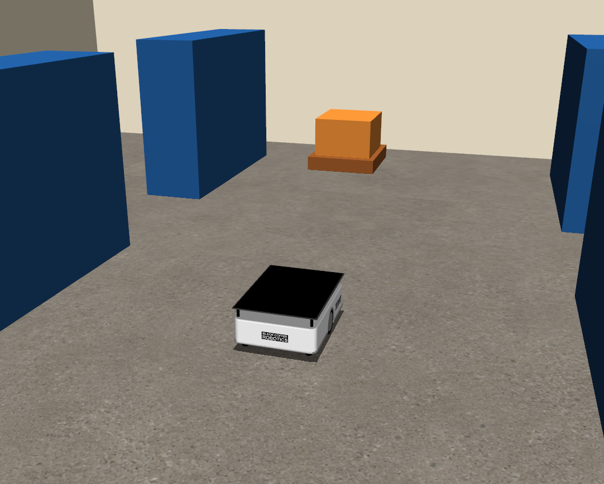

# BCR Bot

https://github.com/blackcoffeerobotics/bcr_bot/assets/13151010/0fc570a3-c70c-415b-8222-b9573d5911c8

## About

This repository contains [Gazebo](https://gazebosim.org/home), [MuJoCo](https://mujoco.org/), and [Isaac Sim](https://developer.nvidia.com/isaac/sim) simulations for a differential drive robot, equipped with an IMU, a depth camera, stereo camera and a 2D LiDAR. ROS2 versions also include [Nav2](https://docs.nav2.org/) and [SLAM Tool Box](https://github.com/SteveMacenski/slam_toolbox) support. Currently, the project supports the following combinations - 

1. [ROS Noetic + Gazebo Classic 11 (branch ros1)](https://github.com/blackcoffeerobotics/bcr_bot/tree/ros1?tab=readme-ov-file#noetic--classic-ubuntu-2004)
2. [ROS2 Humble + Gazebo Classic 11 (branch ros2)](https://github.com/blackcoffeerobotics/bcr_bot/tree/ros2?tab=readme-ov-file#humble--classic-ubuntu-2204)
3. [ROS2 Humble + Gazebo Fortress (branch ros2)](https://github.com/blackcoffeerobotics/bcr_bot/tree/ros2?tab=readme-ov-file#humble--fortress-ubuntu-2204)
4. [ROS2 Humble + Gazebo Harmonic (branch ros2)](https://github.com/blackcoffeerobotics/bcr_bot/tree/ros2?tab=readme-ov-file#humble--harmonic-ubuntu-2204)
5. [ROS2 Humble + Isaac Sim (branch ros2)](https://github.com/blackcoffeerobotics/bcr_bot/tree/ros2?tab=readme-ov-file#humble--isaac-sim-ubuntu-2204)
6. [ROS2 Jazzy + Gazebo Harmonic (branch ros2-jazzy)](https://github.com/blackcoffeerobotics/bcr_bot/tree/ros2-jazzy?tab=readme-ov-file#jazzy--harmonic-ubuntu-2404)
7. [ROS2 Jazzy + Isaac Sim (branch ros2-jazzy)](https://github.com/blackcoffeerobotics/bcr_bot/tree/ros2-jazzy?tab=readme-ov-file#jazzy--isaac-sim-ubuntu-2404)
8. [ROS2 Jazzy + MuJoCo Sim (branch ros2-jazzy)](https://github.com/blackcoffeerobotics/bcr_bot/tree/ros2-jazzy?tab=readme-ov-file#jazzy--mujoco-ubuntu-2404)

Each of the following sections describes depedencies, build and run instructions for the combinations supported by the `ros2-jazzy` branch.

## Jazzy + Harmonic (Ubuntu 24.04)

### Dependencies

Install Gazebo harmonic using ROS2 binaries:
```bash
sudo apt install ros-jazzy-ros-gz-sim ros-jazzy-ros-gz-bridge ros-jazzy-ros-gz-interfaces
```

Install other dependencies with [rosdep](http://wiki.ros.org/rosdep).
```bash
# From the root directory of the workspace. This will install everything mentioned in package.xml
rosdep install --from-paths src --ignore-src -r -y
```

### Build

```bash
colcon build --packages-select bcr_bot
```

### Run

To launch the robot in Gazebo,
```bash
ros2 launch bcr_bot gz.launch.py
```
To view in rviz,
```bash
ros2 launch bcr_bot rviz.launch.py
```

### Configuration

The launch file accepts multiple launch arguments,
```bash
ros2 launch bcr_bot gz.launch.py \
	camera_enabled:=True \
	stereo_camera_enabled:=False \
	two_d_lidar_enabled:=True \
	position_x:=0.0 \
	position_y:=0.0  \
	orientation_yaw:=0.0 \
	odometry_source:=world \
	world_file:=small_warehouse.sdf
```
**Note:** 
1. To use stereo_image_proc with the stereo images excute following command: 
```bash
ros2 launch stereo_image_proc stereo_image_proc.launch.py left_namespace:=bcr_bot/stereo_camera/left right_namespace:=bcr_bot/stereo_camera/right
```
## Jazzy + MuJoCo (Ubuntu 24.04)

### Dependencies

Install the simulation, controller, visualization, and navigation packages:

```bash
sudo apt update
sudo apt install \
  ros-jazzy-mujoco-ros2-control \
  ros-jazzy-mujoco-ros2-control-plugins \
  ros-jazzy-ros2controlcli \
  ros-jazzy-joint-state-broadcaster \
  ros-jazzy-imu-sensor-broadcaster \
  ros-jazzy-diff-drive-controller \
  ros-jazzy-depth-image-proc \
  ros-jazzy-twist-stamper \
  ros-jazzy-teleop-twist-keyboard \
  ros-jazzy-rviz2 \
  ros-jazzy-slam-toolbox \
  ros-jazzy-navigation2 \
  ros-jazzy-nav2-bringup
```

Install the remaining declared dependencies from the workspace root:

```bash
rosdep install --from-paths src --ignore-src -r -y
```

### Build

Run from the workspace root:

```bash
colcon build --packages-select bcr_bot
source install/setup.bash
```

### Run

Launch the robot in the MuJoCo warehouse:

```bash
ros2 launch bcr_bot mujoco.launch.py
```

The launch enables wheel control and odometry, IMU, 2D LiDAR, the depth camera, and stereo cameras. A colored point cloud is generated for the depth camera.

To view the robot and sensor data in RViz, open another sourced terminal:

```bash
ros2 launch bcr_bot rviz.launch.py
```


### Jazzy + Isaac Sim (Ubuntu 24.04)

### Dependencies

In addition to ROS2 Humble [Isaac Sim installation](https://docs.omniverse.nvidia.com/isaacsim/latest/installation/index.html) with ROS2 extension is required. Remainder of bcr_bot specific dependencies can be installed with [rosdep](http://wiki.ros.org/rosdep)

```bash
# From the root directory of the workspace. This will install everything mentioned in package.xml
rosdep install --from-paths src --ignore-src -r -y
```

### Build

```bash
colcon build --packages-select bcr_bot
```

### Run

To launch the robot in Isaac Sim:
- Open Isaac Sim and load the `warehouse_scene.usd` or `scene.usd` from [here](usd). 
- Add in extra viewports for different camera views.
- Start the Simulation: Run the simulation directly within Isaac Sim.
- The following USDs are included in the package:
	- `warehouse_scene.usd` - Warehouse scene with a robot.
	- `scene.usd` - Scene with a robot in a empty world.
	- `bcr_bot.usd` - Robot model that can be imported into any scene.
	- `ActionGraphFull.usd` - Action graph for the robot to publish all the required topics.

To view in rviz:
```bash
ros2 launch bcr_bot rviz.launch.py
```
NOTE: The command to run mapping and navigation is common between all versions of gazebo and Isaac sim see [here](#mapping-with-slam-toolbox).

### Mapping with SLAM Toolbox

SLAM Toolbox is an open-source package designed to map the environment using laser scans and odometry, generating a map for autonomous navigation.

NOTE: The command to run mapping is common between all versions of gazebo and MuJoCo.

To start mapping:
```bash
ros2 launch bcr_bot mapping.launch.py
```

Use the teleop twist keyboard to control the robot and map the area:
```bash
ros2 run teleop_twist_keyboard teleop_twist_keyboard --ros-args -r cmd_vel:=/bcr_bot/cmd_vel
```

To save the map:
```bash
cd src/bcr_bot/config
ros2 run nav2_map_server map_saver_cli -f bcr_map
```

### Using Nav2 with bcr_bot

Nav2 is an open-source navigation package that enables a robot to navigate through an environment easily. It takes laser scan and odometry data, along with the map of the environment, as inputs.

NOTE: The command to run navigation is common between all versions of gazebo, MuJoCo and Isaac sim.

To run Nav2 on bcr_bot:
```bash
ros2 launch bcr_bot nav2.launch.py
```

To choose another map, pass its YAML path
```bash
ros2 launch bcr_bot nav2.launch.py map:=/full/path/to/map.yaml
```

For the included MuJoCo warehouse map:
```bash
ros2 launch bcr_bot nav2.launch.py map:="$(ros2 pkg prefix --share bcr_bot)/config/bcr_map_mujoco.yaml"
```

### Lift platform and carts (this fork, Gz Sim)

The black top block of the robot is a Kiva-style lift (`lift_joint`, prismatic, 0 to 0.08 m), driven by the
gz `JointPositionController` (force PID). Everything below lives inside the robot namespace `/<ns>`:

| Interface | Type | Started by |
|---|---|---|
| `lift_up`, `lift_down` | `std_srvs/Trigger` (ramped, waits for `joint_states`) | `bcr_bot_gz_spawn.launch.py` (`scripts/lift_controller.py`) |
| `lift_state` | `std_msgs/Bool`, transient local, true = up | same |
| `lift_cmd` | `std_msgs/Float64`, target height without ramp | bridge |
| `pick_cart` | `nav2_msgs/action/DockRobot`: `dock_pose` = cart centre in `map`, `use_dock_id: false` | `bcr_bot_nav2.launch.py` (`scripts/cart_handler.py`) |
| `place_cart` | `nav2_msgs/action/DockRobot`: destination centre/orientation in `dock_pose`, `use_dock_id: false` | same |
| `drop_cart` | `nav2_msgs/action/UndockRobot` | same |

`pick_cart` navigates to a staging pose, measures the cart from its four legs in the laser scan (`scripts/cart_legs.py`),
aligns on the cart axis, drives under it, lifts it, and reverses `staging_distance` (default 1.8 m)
on the entry axis. Set `navigate_to_staging_pose: false` when RMF already brought the robot to staging.
Pickup alignment uses `lateral_tolerance` (default 0.04 m predicted lateral error)
and `yaw_tolerance` (default 0.0523599 rad, 3 degrees), without tighter internal caps.
`place_cart` requires a raised lift and a start within 0.5 m of the destination staging pose
(`centre - 1.8 * [cos(yaw), sin(yaw)]`). It corrects alignment at staging with the full cart
footprint, advances 1.8 m, lowers, and reverses 1.8 m to staging. It does not navigate to the
station centre with NavigateToPose; `navigate_to_staging_pose` and `max_staging_time` are unused
for this action. `drop_cart` keeps its existing behavior: lower where it is and reverse
`backout_distance` (default 1.3 m), using UndockRobot's `max_undocking_time`.
Placement compensates the measured cart offset when computing the robot target and staging.
It refuses an unmeasured cart, cart yaw relative to the robot over 0.5 degrees, or a correction
that exceeds `place_staging_compensation_limit` (default 0.10 m). Before lowering, the
estimated cart centre must satisfy `place_tolerance_xy` (default 0.15 m) and
`place_tolerance_yaw` (default 0.0523599 rad, 3 degrees). This map-frame check allows
AMCL uncertainty; the independent raw-laser guard protects the physical entry path.

Placement parameters (lengths in metres, angles in radians):

| Parameter | Default | Purpose |
|---|---|---|
| `place_tolerance_xy` | `0.15` | Maximum estimated cart-centre error before lowering |
| `place_tolerance_yaw` | `0.05235987755982989` (3 degrees) | Maximum estimated cart-heading error before lowering |
| `place_staging_along_tolerance` | `0.05` | Accepted along-axis error at staging |
| `place_staging_lateral_tolerance` | `max(0.03, straight_lateral_limit)`; normally `0.03` | Accepted lateral staging error |
| `place_staging_compensation_limit` | `0.10` | Maximum difference between compensated and nominal staging |

These placement tolerances must be finite and positive. The 3 cm staging lateral default
accounts for map-frame arrival/localization uncertainty independently of `straight_lateral_limit`
(still 0.01 m by default), which limits relative drift during translation in odom.

While a cart is up, `scripts/cart_carry_adapter.py` removes the
legs from the scan (`scan_filtered`, read by AMCL, the costmaps and the collision monitor) and switches the costmap
footprint to the cart's. The cart model (deck underside 0.375 m, 1.12 x 0.92 m between legs) is
`models/lift_cart` in the `indra` package; design notes and measurements in `indra/docs/LIFT_CARTS.md`.

For guarded straight segments only, the adapter grants a renewable 0.6 s robot-footprint lease
through the internal `cart_straight_footprint` SetBool service. It retains cart scan filtering;
the handler independently checks the **raw** 360-degree scan in the 0.75 m strip immediately
beyond the leading cart edge, over the full cart width without lateral inflation. For a
cart rotated relative to the robot, the exact extrusion along the robot's direction also
includes the newly swept side wedge, excluding the currently occupied cart rectangle. Any return
in that strip aborts, including a static obstruction. Both costmaps must publish the robot
footprint before movement. The lease is released on every exit and expires if refresh stops.
Unknown cart geometry refuses a lease. A lease is never used for rotation. Both the adapter
and the costmaps must acknowledge full footprint restoration before a maneuver returns;
missing confirmation latches a fault.

Straight-motion defaults: speed at most 0.15 m/s; `straight_lateral_limit` 0.01 m;
`straight_yaw_limit` 0.0174533 rad; combined `straight_envelope` 0.02 m for centre drift
plus lateral corner excursion; `straight_data_timeout` 0.3 s; `straight_lookahead` 0.75 m.
These bounds cannot be loosened above the stated limits (or below the lookahead) through
parameters. `motion_frame` defaults to the namespaced odom frame to avoid AMCL jumps;
`straight_footprint_padding` defaults to the costmaps' 0.05 m. No fresh scan/odom TF, missing
laser TF, invalid scan coverage, lift inconsistency, footprint loss, drift, or cancellation
stops the action. Endpoint odometry must be within 3 cm of commanded displacement.
An unconfirmed cancellation latches a fault and rejects further cart goals. The private
`~/reset_fault` service (`std_srvs/Trigger`; normally `/<robot>/cart_handler/reset_fault`)
clears it only after receiving `lift_state`, confirming no tracked motion remains pending,
and obtaining normal-footprint acknowledgments from the adapter and both costmaps.
Normal means cart footprint while raised, robot footprint while lowered. The reset releases
any footprint lease before checking. It refuses an active maneuver, unavailable or mismatched
state, missing footprint confirmation, or a lift-state transition during the check; its
response has `success=false` and a reason. It does not move the robot or change lift height.
`place_cart` uses DockRobot errors: no raised cart or invalid pose = `DOCK_NOT_VALID`,
`use_dock_id` = `DOCK_NOT_IN_DB`, staging position = `FAILED_TO_STAGE`, motion/lift =
`FAILED_TO_CONTROL`.

Offline checks do not establish stopping distance, lidar visibility through cart-leg shadows,
cart slip, localization accuracy, or clearance over the whole corridor. A 360-degree scan
does not guarantee unoccluded coverage. The 0.75 m lookahead is a conservative software
default requiring measured braking/cancellation validation. Endpoint map clearance alone
does not guarantee the corridor is clear. Validate the tight-station maneuver in the isolated
simulation before using these changes on hardware.

```bash
ros2 service call /bcr_bot_1/lift_up std_srvs/srv/Trigger
ros2 action send_goal /bcr_bot_1/pick_cart nav2_msgs/action/DockRobot \
  "{use_dock_id: false, dock_pose: {header: {frame_id: map}, pose: {position: {x: 15.0, y: -26.0}, orientation: {z: -0.7071068, w: 0.7071068}}}}"
ros2 action send_goal /bcr_bot_1/drop_cart nav2_msgs/action/UndockRobot "{max_undocking_time: 40.0}"
ros2 action send_goal /bcr_bot_1/place_cart nav2_msgs/action/DockRobot \
  "{use_dock_id: false, dock_pose: {header: {frame_id: map}, pose: {position: {x: 15.0, y: -28.0}, orientation: {z: -0.7071068, w: 0.7071068}}}}"
ros2 service call /bcr_bot_1/cart_handler/reset_fault std_srvs/srv/Trigger '{}'
```

### Simulation and Visualization
1. Gz Sim (Ignition Gazebo) (small_warehouse World):
	

2. MuJoCo:
   

3. Isaac Sim:
	 

4. Rviz (Depth camera) (small_warehouse World):
	
